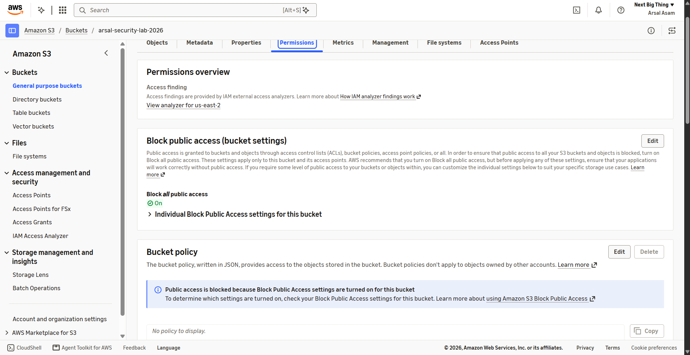
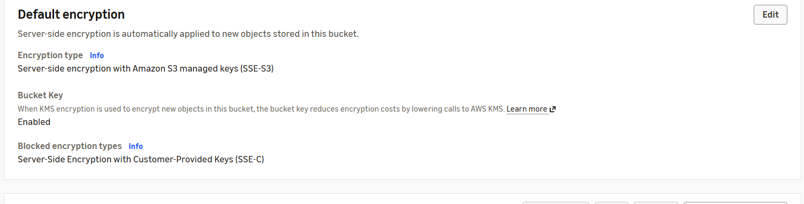
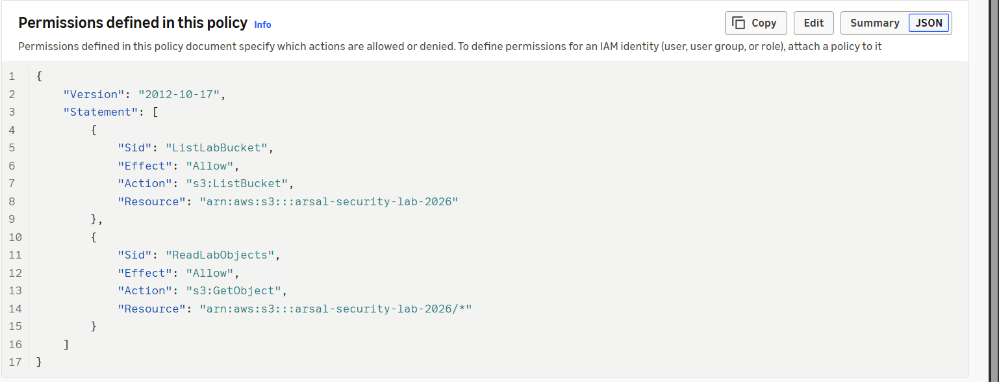
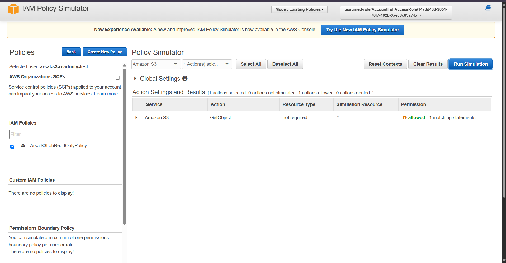
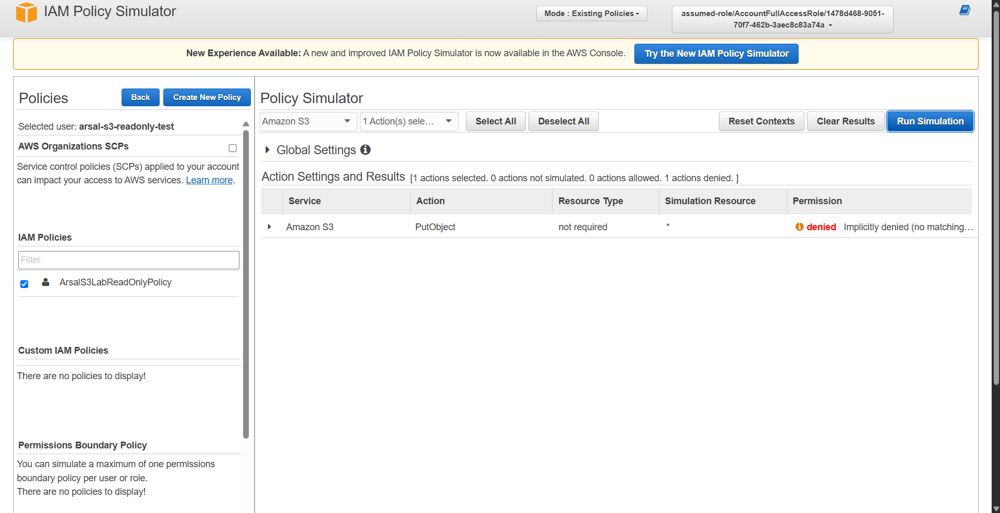
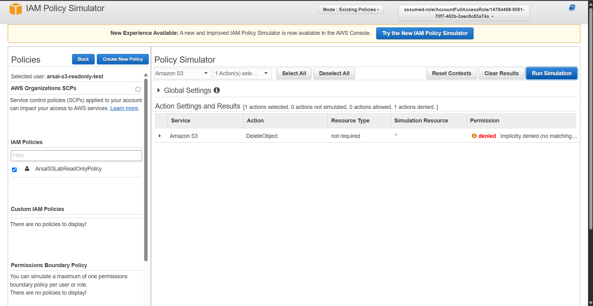

# AWS S3 Security Lab

## Project Overview

This hands-on cybersecurity project explores securing cloud storage in Amazon Web Services (AWS) using Amazon S3 and Identity and Access Management (IAM).

The goal was to configure private cloud storage, apply encryption, implement least-privilege access controls, and evaluate IAM permissions using the AWS IAM Policy Simulator.

## Technologies Used

- Amazon Web Services (AWS)
- Amazon S3
- AWS Identity and Access Management (IAM)
- IAM Policy Simulator
- JSON

## Project Implementation

### 1. Secure S3 Bucket Configuration

Created an Amazon S3 bucket in the `us-east-2` (Ohio) region.

Security configurations included:

- Enabled Block All Public Access
- Disabled access control lists (ACLs)
- Enabled default server-side encryption using SSE-S3
- Uploaded a harmless sample text file to test private object storage

### 2. Least-Privilege IAM Policy

Created a customer-managed IAM policy granting only the following permissions:

- `s3:ListBucket` — List objects in the designated S3 bucket
- `s3:GetObject` — Read objects within the designated bucket

The policy was restricted to the lab bucket and its objects, rather than all AWS resources.

Created a dedicated IAM test user and attached the read-only policy.

### 3. IAM Policy Simulation

Used the AWS IAM Policy Simulator to evaluate three S3 actions.

| Action | Simulated Result |
|---|---|
| `s3:GetObject` | Allowed |
| `s3:PutObject` | Implicitly Denied |
| `s3:DeleteObject` | Denied |

The results demonstrated that the IAM policy grants read access without granting object modification or deletion permissions.

**Testing limitation:** AWS Organizations Service Control Policies (SCPs) were excluded during these simulations to isolate the IAM policy's behavior. These results do not establish that the actions would succeed in the live environment.

### 4. Public Access Verification

Verified that Block All Public Access remained enabled on the S3 bucket after configuring IAM permissions.

## Security Concepts Demonstrated

## Lab Screenshots

### S3 Public Access Configuration

### S3 Encryption Configuration

### Least-Privilege IAM Policy

### IAM Policy Simulator Results

**GetObject — Allowed**

**PutObject — Implicitly Denied**

**DeleteObject — Implicitly Denied**

- **Least privilege:** Restricting permissions to only those necessary for a task
- **Identity and access management:** Controlling which identities can access AWS resources
- **Encryption at rest:** Protecting stored data using SSE-S3
- **Public access prevention:** Using S3 Block Public Access settings
- **Policy evaluation:** Testing permitted and denied actions using the IAM Policy Simulator
- **Resource scoping:** Restricting permissions to specific AWS resources through ARNs

## Key Takeaways

This lab provided practical experience configuring cloud storage security, writing resource-scoped IAM policies, and evaluating access controls.

It also demonstrated how IAM permissions interact with broader AWS security controls, including AWS Organizations SCPs.

## Future Improvements

- Evaluate IAM policies using additional AWS security analysis tools
- Explore AWS CloudTrail for auditing API activity
- Practice secure access using temporary credentials and IAM roles
- Expand testing to include additional access scenarios

## Security Notice

This repository documents a learning environment. No AWS credentials, access keys, or sensitive data are included.
